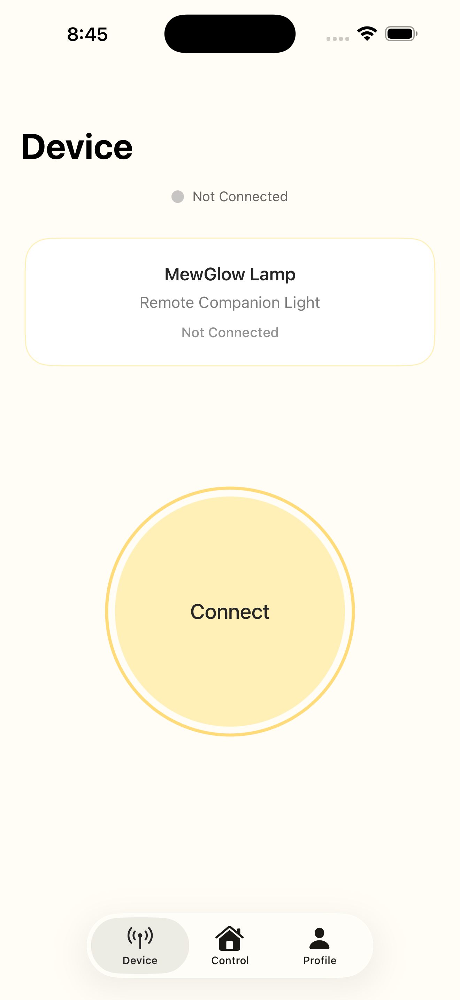
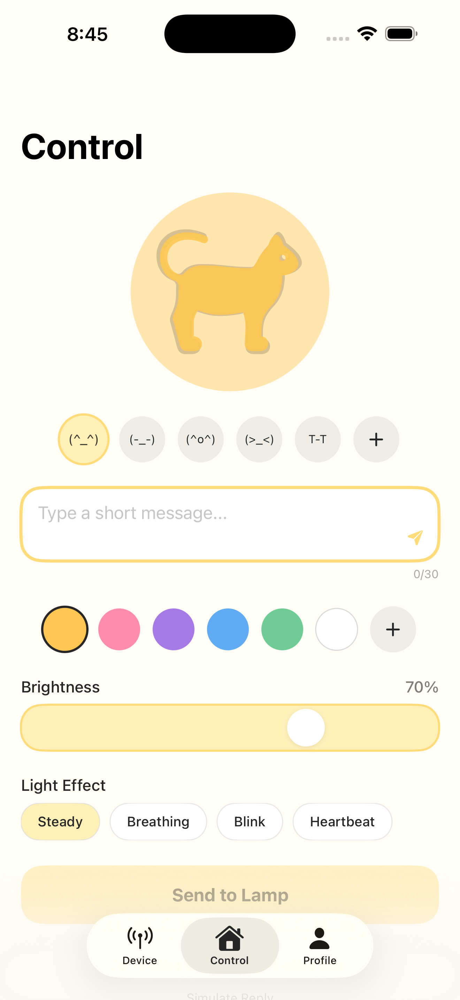
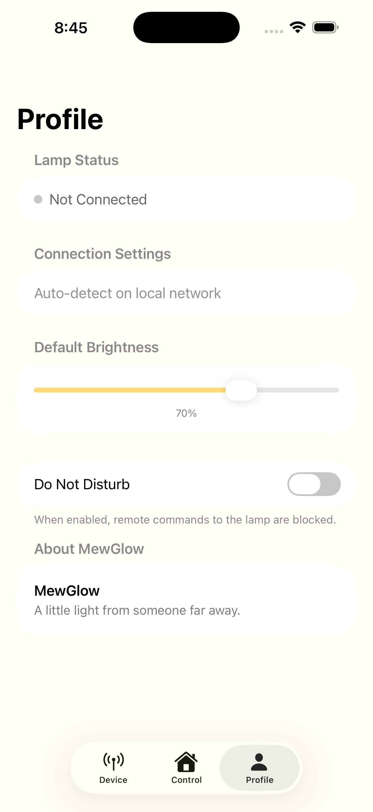
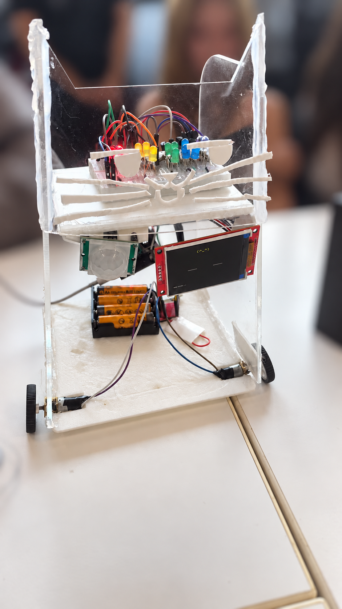

# ESP32 MewGlow

**Platform:** ESP32 · **Development Environment:** Arduino IDE · **Language:** Arduino/C++

MewGlow is an interactive companion robot that combines movement, expressive lighting, a digital cat face, motion sensing, and Wi-Fi control. An ILI9341 TFT display shows animated eyes and emoticons, while five colored LEDs reproduce app-selected colors and visual effects. A PIR sensor detects nearby movement, and a TB6612FNG motor driver controls the two motors so the robot can physically respond.

The project was designed to make an embedded system feel more expressive than a conventional remote-controlled vehicle. Instead of using movement alone, the cat communicates through eye shapes, blinking, color, brightness, and motion. Different emoticons are interpreted as moods such as happy, angry, sleepy, sad, and love. These moods can influence the robot's display and movement behavior.

The companion iOS app was built with SwiftUI in Xcode. It provides separate Device, Control, and Profile screens so the user can connect to MewGlow, write a short message, choose an emoticon and color, adjust brightness, select a lighting effect, and manage basic preferences. The full Xcode project is included in [`app/MewGlow`](app/MewGlow).

The ESP32 runs a local HTTP server with three endpoints. `GET /ping` verifies the connection from the app, `GET /status` reports the Wi-Fi connection, current mood, message, IP address, PIR readiness, and reply state, and `POST /command` accepts JSON values for the displayed message, emoticon, RGB color, brightness, and lighting effect. Supported LED effects include steady light, breathing, blinking, and a heartbeat pattern.

The hardware uses an ESP32, an ILI9341 TFT display, a PIR motion sensor, a TB6612FNG dual-motor driver, two motors, and red, yellow, green, blue, and white LEDs. The firmware demonstrates Wi-Fi networking, HTTP request handling, JSON parsing, PWM output, RGB-to-five-channel color conversion, display graphics, non-blocking eye animation, sensor input, motor control, and automatic Wi-Fi reconnection.

Short subsystem demonstrations:

- [Watch the LED breathing-effect test](media/led-breathing-effect-test.mp4)
- [Watch the wheel-motion test](media/wheel-motion-test.mp4)

These clips document the lighting and motor subsystems separately; a full video of the assembled robot operating was not recorded.

The current firmware can connect to a local Wi-Fi network, receive app commands, update its face and lighting, and react to nearby activity. Repeated PIR triggers are interpreted as a wave, while ordinary motion starts a mood-based movement sequence. Multiple recent triggers activate a more curious response. The robot can also provide non-blocking visual feedback through a physical reply button on GPIO 39 and perform a small idle fidget after five minutes without activity.

The repository also preserves an earlier [Wi-Fi RGB control prototype](versions/wifi_rgb_control_prototype.ino). This smaller program demonstrates the original app-to-ESP32 communication flow, RGB PWM control, lighting effects, mood-command parsing, and compatibility with both ESP32 Arduino Core 2.x and 3.x. It is kept separate from the main firmware because both sketches define their own `setup()` and `loop()` functions.

AI tools were used to assist with parts of the coding process and documentation. The hardware integration, physical testing, troubleshooting, and final behavior were reviewed and refined as part of the project.

Before uploading the firmware, replace `YOUR_WIFI_NAME` and `YOUR_WIFI_PASSWORD` in `MewGlow_firmware.ino` with credentials for the local network. Update `LampService.host` in the iOS project to the IP address printed by the ESP32 Serial Monitor. The iPhone and ESP32 must be connected to the same local network. The public repository intentionally contains no real Wi-Fi credentials.

Required Arduino libraries:

- ESP32 board support package
- ArduinoJson
- Adafruit GFX Library
- Adafruit ILI9341

Main wiring:

| Component | ESP32 pins |
| --- | --- |
| Red, yellow, green, blue, white LEDs | 13, 32, 14, 27, 26 |
| TB6612FNG motor A | AIN1 16, AIN2 17, PWMA 4 |
| TB6612FNG motor B | BIN1 22, BIN2 23, PWMB 19 |
| PIR sensor | 34 |
| Physical reply button | 39 |
| ILI9341 display | CS 21, DC 25, MOSI 5, SCLK 18, RST 33 |

The completed MewGlow hardware prototype is shown below. The surrounding background has been blurred to protect the privacy of people in the original photograph.

